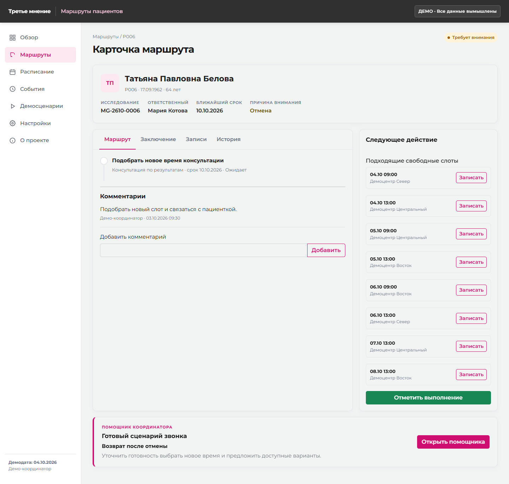
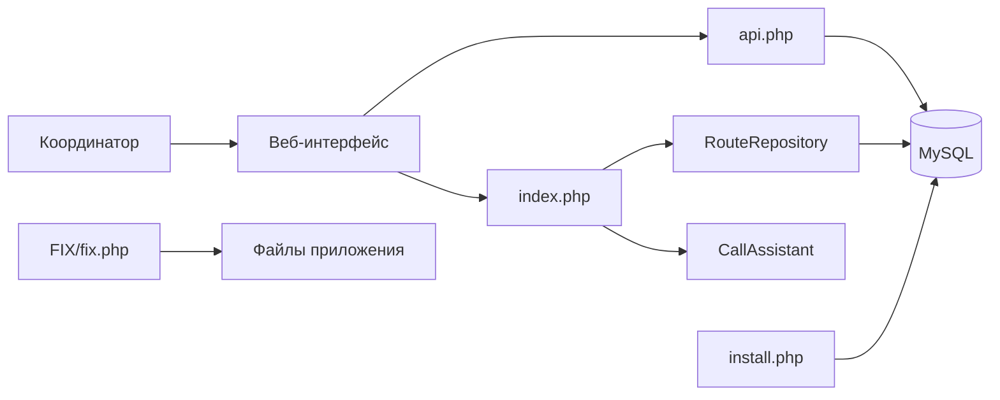
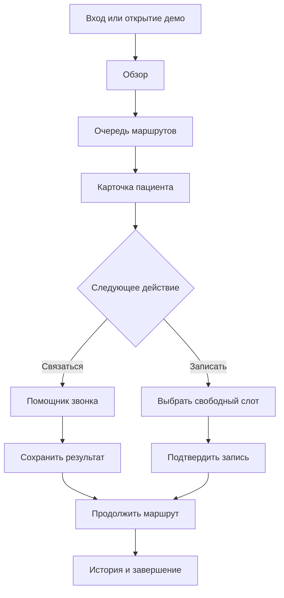
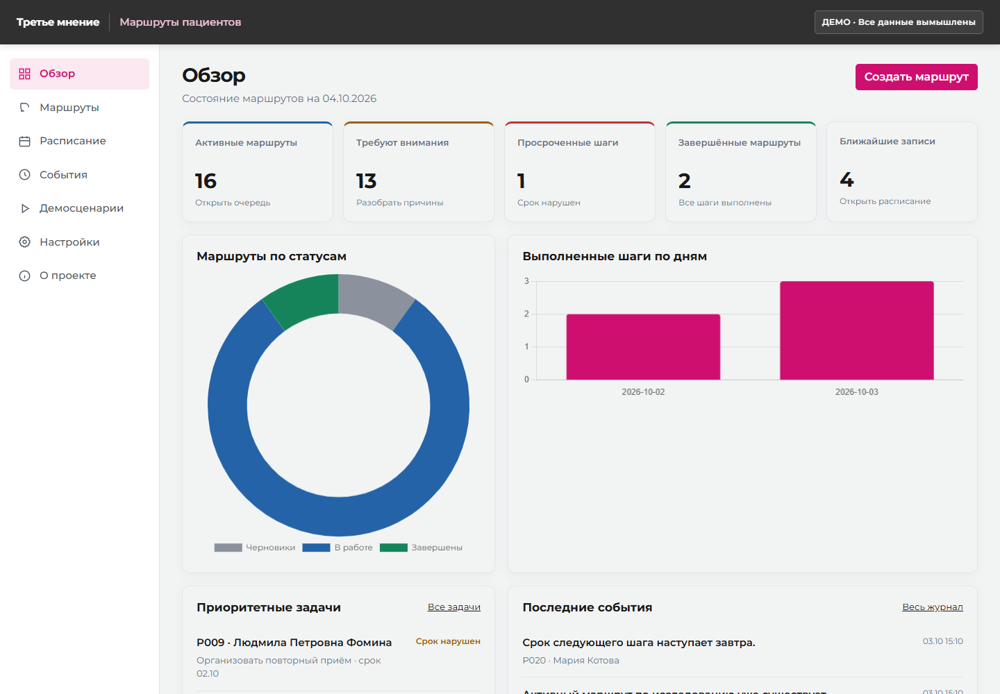
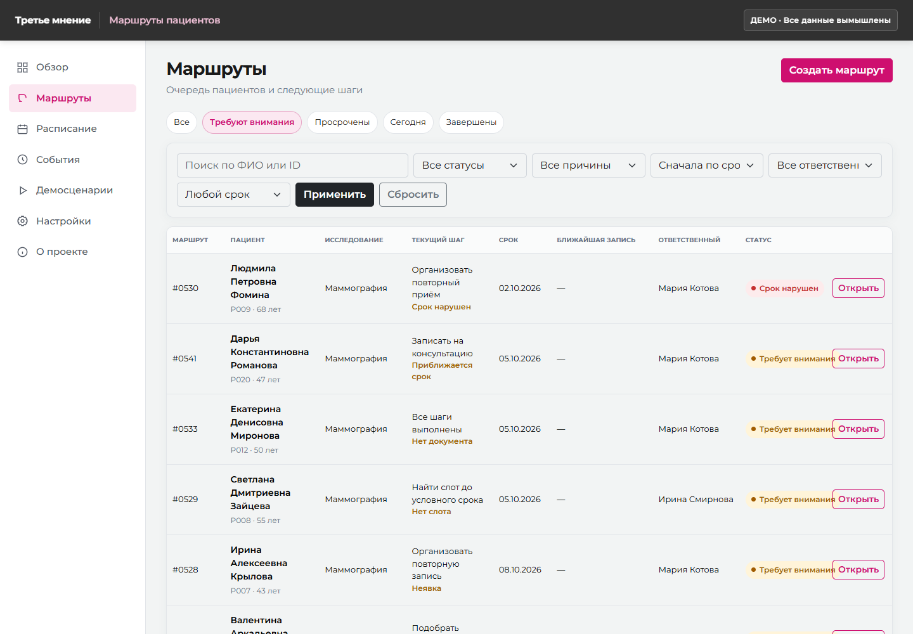

# RouteGuard — маршруты пациентов



RouteGuard — демонстрационный веб-сервис для координации маршрутов пациентов после получения заключения. Система помогает контролировать следующие шаги, сроки, записи и ситуации, требующие внимания: отмены, неявки и отсутствие свободных слотов. В карточке маршрута координатору доступен помощник звонка с готовым организационным сценарием и фиксацией результата. Все данные синтетические; сервис не ставит диагнозы и не формирует медицинские рекомендации.

> **Статус:** функциональный демонстрационный прототип. Интеграции с МИС, SSO, телефонией, SMS и почтой не подключены.

## Возможности

- обзор показателей, приоритетных задач и событий;
- очередь маршрутов с поиском, фильтрами и сортировкой;
- карточка пациента с заключением, шагами, записями и историей;
- помощник звонка с адаптивным текстом, чек-листом и сохранением результата;
- выбор свободного слота, перенос, отмена и фиксация неявки;
- контроль обязательных шагов и подтверждающих документов;
- отдельная изолированная демосессия для каждого посетителя;
- установка на PHP/MySQL и однофайловые обновления через `FIX/fix.php`.

## Архитектура



Приложение построено как компактный серверный PHP-монолит. Интерфейс рендерится на сервере, действия проходят через единый обработчик с CSRF-проверкой, а доступ к данным изолирован идентификатором рабочего пространства.

[Подробная архитектура →](docs/ARCHITECTURE.md)

## Пользовательский путь



[Пользовательские сценарии →](docs/USER_FLOW.md)

## Технологии

| Уровень | Технологии |
|---|---|
| Backend | PHP 8.2+, PDO |
| Production DB | MySQL 5.7/8.0 |
| Локальная разработка | SQLite |
| Frontend | HTML, CSS, JavaScript, Bootstrap 5 |
| Диаграммы | Chart.js |
| Сервер | Apache с `.htaccess` |

Все frontend-зависимости находятся в репозитории: для работы интерфейса CDN не требуется.

## Интерфейс

| Обзор | Очередь маршрутов |
|---|---|
|  |  |

Интерфейс адаптирован для desktop, планшета и мобильного экрана. Дополнительные состояния находятся в каталоге [`screenshots/`](screenshots/).

## Навигация по репозиторию

```text
routeguard/
├── app/                    # Бизнес-логика и доступ к данным
├── assets/                 # Стили, JavaScript, шрифты и библиотеки
├── docs/                   # Архитектура и эксплуатационная документация
├── FIX/fix.php             # Однофайловое обновление установленной версии
├── screenshots/            # Скриншоты интерфейса
├── storage/                # Локальные данные; содержимое не коммитится
├── tests/                  # Автоматические проверки
├── api.php                 # Обработчик пользовательских действий
├── index.php               # Серверный интерфейс
├── install.php             # Одноразовый установщик
├── schema.sql              # Схема MySQL
└── config.example.php      # Безопасный шаблон конфигурации
```

[Полное описание модулей →](docs/REPOSITORY.md)

## Быстрый локальный запуск

Требуются PHP 8.2+ и расширения PDO SQLite, mbstring, json и session.

```powershell
$env:RG_DEV='1'
php -S 127.0.0.1:8765
```

Откройте `http://127.0.0.1:8765` и нажмите **«Открыть демо»**. Локальный режим сам создаст SQLite-базу в `storage/`; она исключена из Git.

## Проверка

```powershell
$env:RG_DEV='1'
php tests/smoke.php
php tests/call_assistant.php
```

Дополнительно рекомендуется выполнить PHP lint и проверку JavaScript:

```powershell
rg --files -g "*.php" | ForEach-Object { php -l $_ }
node --check assets/app.js
```

[Состав проверок и результаты →](docs/TESTING.md)

## Развёртывание

Production-конфигурация создаётся из `config.example.php`. Настоящий `config.php`, пароли базы данных, токены, локальные БД, архивы и резервные копии исключены из репозитория.

[Инструкция по установке на SprintHost →](docs/DEPLOYMENT.md)

## Документация

- [Архитектура](docs/ARCHITECTURE.md)
- [Пользовательский путь и демосценарии](docs/USER_FLOW.md)
- [Навигация и описание модулей](docs/REPOSITORY.md)
- [Развёртывание](docs/DEPLOYMENT.md)
- [Тестирование](docs/TESTING.md)
- [Сторонние компоненты](THIRD_PARTY_NOTICES.md)

## Ограничения

- используются только синтетические пациенты и документы;
- помощник звонка работает по детерминированным шаблонам, без генеративного ИИ;
- сервис не предназначен для хранения реальных медицинских данных;
- интеграции с внешними медицинскими и коммуникационными системами не реализованы.
