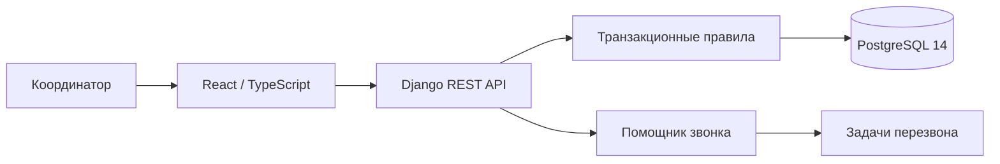
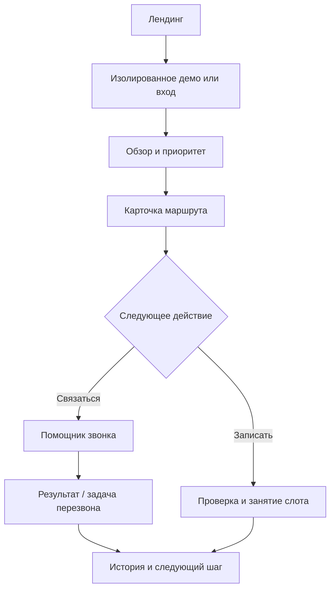

# RouteGuard — маршруты пациентов без потерянных шагов

RouteGuard — самостоятельный сервис для координации организационных маршрутов после получения медицинского заключения. Он объединяет сроки, записи, звонки, задачи и историю решений, показывает понятный приоритет и не даёт медицинских рекомендаций. Встроенное демо создаёт изолированное рабочее пространство с 20 воспроизводимыми сценариями.

> Статус: готовый демонстрационный продукт. Все данные синтетические; интеграции с МИС, телефонией и уведомлениями обозначены как следующие этапы.


Ознакомительная страница — это семь связанных сцен от проблемы разрозненных действий до рабочего места координатора и безопасного демо. На desktop маршрут отображается настоящей процедурной Three.js-сценой: GSAP ScrollTrigger ведёт камеру по пространственной кривой, перестраивает карточки и раскрывает объёмные панели кабинета, звонка и аналитики. На мобильных устройствах, при `prefers-reduced-motion` и без WebGL используется лёгкая HTML/CSS-схема. Заголовок и CTA не зависят от загрузки 3D.

## Как устроено решение



Пользователь открывает обзор, выбирает маршрут по объяснимому приоритету, связывается с пациентом или выбирает свободный слот, фиксирует результат и видит его в истории. Результат «Перезвонить» создаёт отдельную задачу с датой и ответственным.

## Возможности

- отдельные постоянные и гостевые рабочие пространства;
- 20 сценариев P001–P020 и восстановление демоданных;
- обзор, поиск, фильтры и объяснение приоритета;
- карточка маршрута со статусами, шагами, записями, документами и аудитом;
- помощник звонка: цель, готовый текст, вопросы и фиксация результата;
- «Мои задачи», включая реальные задачи повторного звонка;
- безопасное бронирование: транзакция, блокировка, идемпотентность и запрет прошедших слотов;
- адаптивный интерфейс для 390, 768, 1280 и 1440 px с карточкой пациента справа или поверх очереди;
- безопасные ответы API без вывода внутренних исключений.

## Пользовательский путь



## Быстрый локальный запуск

Требуются Python 3.11+ и Node.js 22+.

```bash
python -m venv .venv
.venv/Scripts/pip install -r requirements-dev.txt
python manage.py migrate
cd frontend
npm ci
npm run build
cd ..
python manage.py runserver
```

Откройте `http://127.0.0.1:8000/` и нажмите «Открыть демо». Локально без `DATABASE_URL` используется только техническая SQLite-база; production рассчитан на PostgreSQL.

## Навигация по репозиторию

| Путь | Назначение |
|---|---|
| `frontend/` | React 19, TypeScript, Vite, Three.js / React Three Fiber, e2e-тесты |
| `frontend/src/landing/` | семь DOM-сцен лендинга, scroll-driven WebGL-маршрут и адаптивный fallback |
| `core/` | модели, REST API, правила маршрутов, демосценарии и backend-тесты |
| `routeguard/` | конфигурация Django и WSGI |
| `backend_static/` | готовая production-сборка интерфейса |
| `docs/` | архитектура, сценарии, тестирование, миграция и размещение |
| `deploy/sprinthost/` | шаблоны точки входа для SprintHost |
| `scripts/build_release.ps1` | повторяемая сборка приватного архива для хостинга |

Сборщик также создаёт приватный `FIX/fix.php`: это однофайловый автоматический установщик и обновлятор для загрузки в `public_html/FIX/fix.php`. Он выполняет резервное копирование, развёртывание, установку Python-зависимостей, миграции, сборку статики и первичное создание владельца. В Windows весь SSH-деплой запускается двойным щелчком по `DEPLOY-TO-HOSTING.cmd`; архив отдельно переносить не требуется.

## Проверки

```bash
python manage.py check
python manage.py test
cd frontend
npm audit
npm run build
npx playwright test
```

Проверяются 20 сценариев, изоляция рабочих пространств, защита от дублей, стабильность `completed_at`, создание callback-задачи, прошедшие слоты, идемпотентность и сквозной путь на четырёх разрешениях.

## Документация

- [Архитектура](docs/ARCHITECTURE.md)
- [Демосценарии](docs/DEMO_SCENARIOS.md)
- [Развёртывание на SprintHost](docs/DEPLOYMENT_SPRINTHOST.md)
- [Тестирование](docs/TESTING.md)
- [3D-лендинг](docs/LANDING_3D.md)
- [Миграция и откат](docs/MIGRATION.md)
- [Аудит предыдущей версии](docs/CURRENT_AUDIT.md)

## Безопасность и границы

Production-секреты и реквизиты базы не хранятся в Git. Публичное демо использует синтетические данные и не предназначено для персональных или медицинских сведений. Перед реальной эксплуатацией нужны юридическая оценка, модель угроз, резервное копирование и интеграционное тестирование в инфраструктуре заказчика.

Лицензии сторонних компонентов перечислены в [THIRD_PARTY_NOTICES.md](THIRD_PARTY_NOTICES.md).
