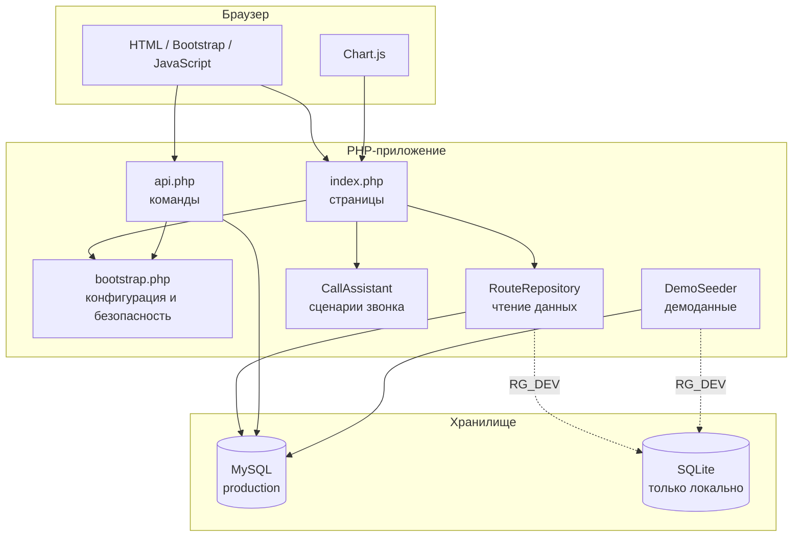
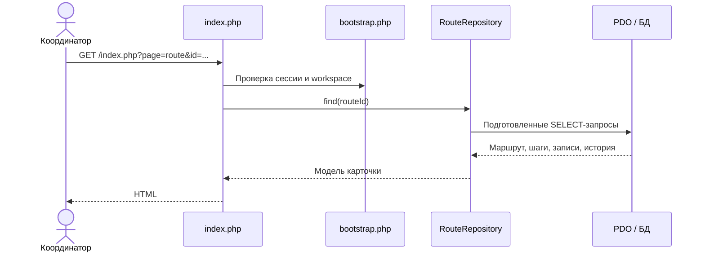
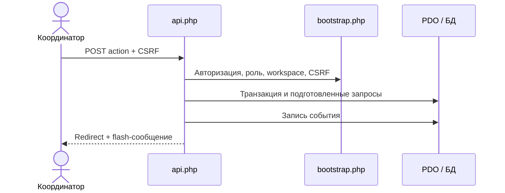

# Архитектура RouteGuard

## Общий подход

RouteGuard — компактное серверное PHP-приложение без отдельного frontend-сборщика и фоновых сервисов. Такой формат выбран для размещения на обычном виртуальном хостинге: приложение требует только PHP, PDO, MySQL и Apache.

## Компоненты

| Компонент | Ответственность |
|---|---|
| `index.php` | Маршрутизация страниц и серверный рендеринг интерфейса |
| `api.php` | Изменяющие состояние команды, валидация и перенаправления |
| `app/bootstrap.php` | Загрузка конфигурации, сессии, PDO, CSRF и общие функции |
| `app/RouteRepository.php` | Запросы чтения для обзора, очереди, карточки и расписания |
| `app/CallAssistant.php` | Выбор организационного сценария звонка по состоянию маршрута |
| `app/DemoSeeder.php` | Создание изолированных синтетических рабочих пространств |
| `install.php` | Проверка окружения, создание схемы и первого владельца |
| `FIX/fix.php` | Авторизованное файловое обновление уже загруженной версии |

## Обработка запроса

### Чтение страницы

### Изменение состояния

## Изоляция данных

Каждая публичная демосессия получает собственный `workspace_id`. Все рабочие сущности содержат этот идентификатор, а серверные запросы дополнительно фильтруются по текущему workspace. Это предотвращает изменение данных другой демосессии через подмену числового ID.

## Помощник звонка

`CallAssistant` не обращается к внешним сервисам и не использует генеративный ИИ. Он выбирает заранее подготовленный организационный сценарий по причине внимания, текущему шагу и записи пациента. В результате возвращаются цель, вступление, вопросы, предложение, завершение и рекомендуемое следующее действие.

## Модель безопасности

- сессии используются для пользователя и рабочего пространства;
- изменяющие запросы принимаются только методом POST;
- формы защищены CSRF-токеном;
- SQL выполняется через подготовленные запросы;
- действия проверяют принадлежность сущности текущему workspace;
- настоящий `config.php` и локальные данные исключены из Git;
- `.htaccess` закрывает конфигурацию, схемы и внутренние каталоги от прямого доступа;
- `FIX/fix.php` требует отдельный maintenance token при веб-запуске.

## Границы решения

В текущую архитектуру не входят телефония, МИС, SSO, очереди сообщений, фоновые задачи и отправка уведомлений. Эти интеграции должны добавляться через отдельные адаптеры, не смешивая их с правилами маршрутов и шаблонами помощника.
