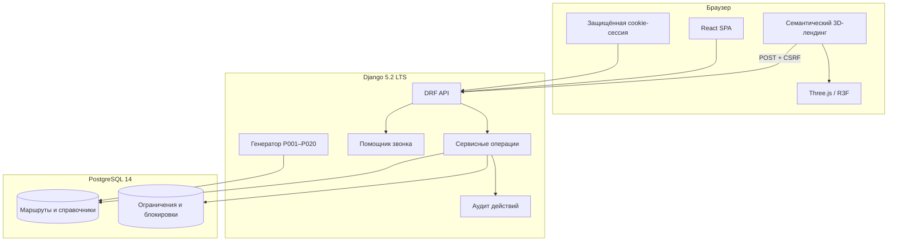

# Архитектура RouteGuard v2

## Контуры

Frontend собирается локально Vite и на production отдаётся как статический набор файлов. Django работает через WSGI и отвечает за `/api/`, `/`, `/app/`; Node.js на сервере не требуется.

## Модули

| Модуль | Ответственность |
|---|---|
| `core/models.py` | workspace, сотрудники, маршруты, шаги, слоты, записи, задачи, документы и аудит |
| `core/services.py` | транзакционные переходы, бронирование, завершение, callback-задачи и приоритет |
| `core/call_assistant.py` | организационный сценарий разговора без клинической интерпретации |
| `core/demo.py` | детерминированные сценарии P001–P020 |
| `core/views.py` | HTTP-контракт, фильтры и проверка границ workspace |
| `frontend/src/App.tsx` | пользовательский путь и состояния UI |
| `frontend/src/api.ts` | единый клиент API и CSRF |
| `frontend/src/landing/LandingExperience.tsx` | семь семантических сцен, CTA, responsive и fallback |
| `frontend/src/landing/RouteScene.tsx` | процедурная 3D-линия, станции, освещение и camera-on-rail |

## Ключевые инварианты

1. Любая рабочая сущность принадлежит одному workspace; пользователь не может передать ID из другого.
2. GET-запросы ничего не изменяют. Пересчёт маршрута вызывается только после команды.
3. Для одного исследования допустим только один активный или черновой маршрут — это ограничение БД, а не частная проверка по коду пациента.
4. `completed_at` заполняется один раз и не меняется повторным выполнением команды.
5. Бронирование блокирует шаг и слот через `select_for_update`, проверяет время и защищено уникальными ограничениями.
6. Повтор команды с одинаковым `Idempotency-Key` возвращает прежний результат.
7. «Время согласовано» фиксирует контакт, но не создаёт запись без явно выбранного слота.
8. «Перезвонить» без даты отклоняется; с датой создаёт объект `Task`.

## Приоритет

Приоритет не является скрытым ML-решением. Порядок правил прозрачен: просроченный срок → задача на сегодня → отмена/неявка → нет слота/ответственного/документа → срок сегодня или завтра → плановая работа. API возвращает уровень и текст причины, UI показывает их сотруднику.

## Изоляция демо

Каждый гость получает новый UUID workspace в серверной сессии. Его данные удаляются после TTL командой `cleanup_demo`; постоянные пространства не сбрасываются и не смешиваются с гостевыми. Условная демодата хранится отдельно, а реальное время события остаётся в аудите.

## Безопасность

- CSRF проверяется и для авторизованных пользователей, и для гостевой session-сессии;
- cookie имеют `HttpOnly`, `SameSite=Lax`, а в production — `Secure`;
- production требует уникальный `DJANGO_SECRET_KEY`;
- наружу возвращаются безопасные сообщения, полная ошибка остаётся в серверном журнале;
- SQL формирует ORM, мутации выполняются в транзакциях;
- пароль БД и ключ Django находятся только в `.env` выше публичного каталога.
