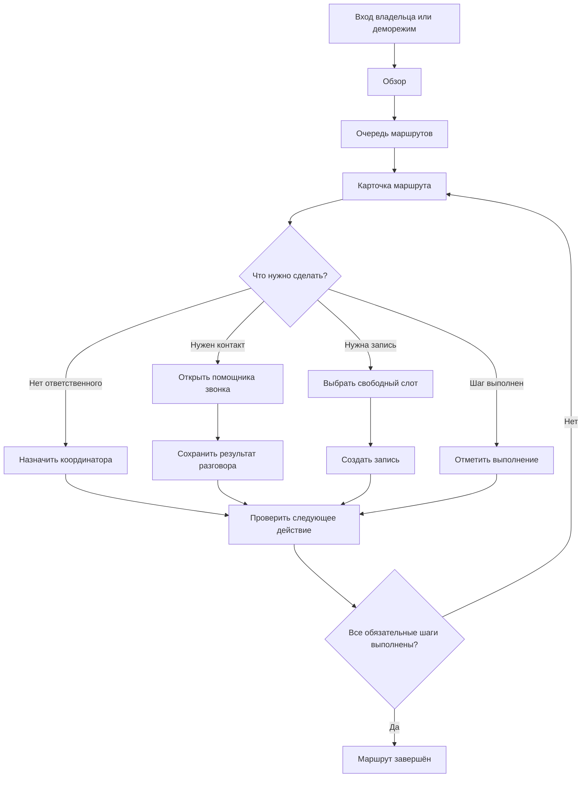
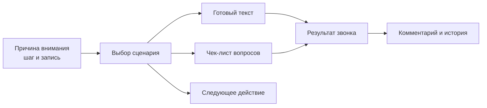

# Пользовательский путь и сценарии

## Основной путь координатора

## Помощник звонка

В карточке маршрута помощник формирует организационный сценарий, соответствующий текущей ситуации. Координатор видит контекст, готовый текст, вопросы и действие после разговора.

Помощник ограничен организацией маршрута: он не интерпретирует заключение и не предлагает медицинские решения.

## Проверяемые демосценарии

| Код | Исходная ситуация | Ожидаемое действие |
|---|---|---|
| `P001` | Новый маршрут | Подтвердить план, выбрать слот и выполнить шаг |
| `P006` | Запись отменена пациентом | Использовать сценарий возврата, согласовать новое время |
| `P007` | Зафиксирована неявка | Связаться и организовать повторную запись |
| `P008` | Нет слота до условного срока | Согласовать другую дату или площадку |
| `P009` | Срок шага истёк | Найти маршрут через очередь внимания |
| `P013` | Два обязательных шага | Не допустить преждевременного завершения |
| `P015` | Повторное создание маршрута | Показать предупреждение и не создать дубль |

Дополнительный сценарий `P012` проверяет обязательную синтетическую заглушку документа: без неё маршрут не завершается.

## Результаты звонка

Координатор может сохранить один из результатов:

- контакт установлен;
- время согласовано;
- требуется повторный звонок;
- пациент не ответил;
- пациент отказался от разговора.

Результат и необязательный комментарий добавляются в историю маршрута. Согласованное время не бронируется автоматически: координатор отдельно выбирает подтверждённый свободный слот.
